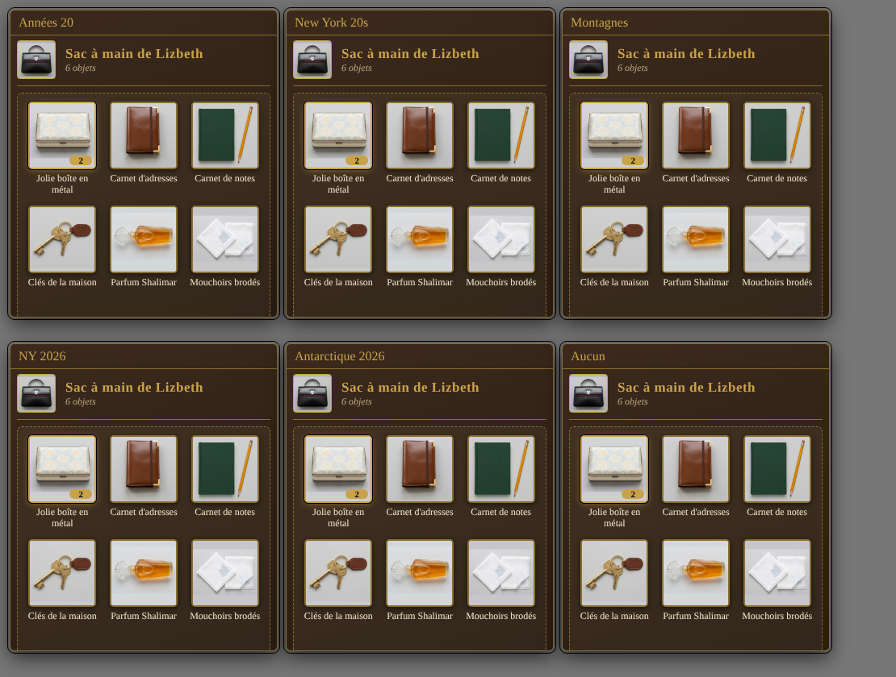

# CoC7 Conteneurs

Module Foundry VTT (v13/v14) pour le système Call of Cthulhu 7e (CoC7) : fait d'un objet un **conteneur** (sac à main, valise, sac à dos…) dans lequel on glisse d'autres objets, et qui reste sur la **fiche du personnage**.

## Utilisation
0. **Créer un conteneur neuf** : bouton « Nouveau conteneur » en haut du dossier Objets (MJ), ou la petite valise à côté du « + » de la section Objets sur une fiche. On choisit un modèle (sac à main, sac à dos, valise, besace, mallette, trousse, coffret, malle), un nom, une image et une description.
1. Sur la fiche, onglet **Possessions**, le MJ clique sur l'icône « valise » d'un objet : il devient un conteneur.
2. Glisser un objet de la fiche (ou du dossier Objets) **sur la ligne du conteneur** : il y est rangé (l'original est retiré de la fiche).
3. Cliquer sur l'icône valise pour **ouvrir** le conteneur : on y voit son contenu, on peut y glisser d'autres objets, cliquer sur la flèche pour **sortir** un objet, ou le glisser vers la fiche.
4. Le MJ peut détruire un objet du conteneur ou retirer le statut de conteneur (quand il est vide).

## Poids et capacité
Chaque objet rangé compte pour son **poids × sa quantité** (champs « poids » et « quantité » de l'objet CoC7). La fenêtre affiche le total contenu, sans oublier ce que contiennent les conteneurs imbriqués. Le MJ clique sur la jauge pour régler la **capacité maximale** (0 = illimitée) : un objet qui la ferait dépasser est refusé, et la capacité de chaque conteneur parent est respectée aussi.

## Poupées russes
Un conteneur peut en contenir d'autres, sans limite de niveaux : glisse un conteneur dans un autre (ex. un coffret de maquillage dans un sac à main). Sa tuile porte un badge doré avec le nombre d'objets qu'il contient ; un clic sur son nom l'ouvre dans une seconde fenêtre. On peut aussi glisser un objet directement sur la tuile du conteneur pour le ranger dedans, et déplacer un objet d'un conteneur à un autre.

## Thème
La fenêtre du conteneur suit le **thème choisi par chaque joueur** dans le module « CoC7 – Cartes de chat thématiques » (Années 20, New York années 20, Montagnes Hallucinées, New York 2026, Antarctique 2026) : couleurs, polices et arrondis. Chacun voit donc la fenêtre à son thème, et la bascule d'époque la change toute seule. Sans ce module, ou avec le thème « Aucun », la fenêtre garde son style par défaut (cuir sombre et filets dorés).

## Notes
- Aucune modification de CoC7 : le contenu est enregistré dans les données de l'objet. Module désactivé, le conteneur reste un objet normal.
- Supprimer un conteneur supprime aussi son contenu.
- Types acceptés dans un conteneur : objet, livre, sort, arme, armure.

## English
**CoC7 Containers** turns any Call of Cthulhu 7th edition item into a container (handbag, backpack, suitcase…). Drag items onto the container's row on the character sheet, open it to see its contents in a themed window, drag items out again. Containers nest like Russian dolls, each can have a weight capacity (set by the GM by clicking the gauge), and the window follows the theme each player picked in *CoC7 – Themed Chat Cards* (optional). Nothing in the CoC7 system is modified: contents are stored in the item's flags, so if the module is disabled the container is just an ordinary item. UI available in English and French. Requires the CoC7 system (8.x), Foundry v13 or v14 (tested on v14).

## Installation
Manifeste : `https://github.com/magisterphamtom/coc7-conteneurs/releases/latest/download/module.json`

Licence MIT.

## Investigateurs de l'Ombre (0.6.0)

Le module fonctionne aussi avec le système Investigateurs de l'Ombre : les objets de type Équipement deviennent des conteneurs ; armes, tomes et sorts peuvent y être rangés. Les objets rangés sous CoC7 ressortent avec le bon type.
